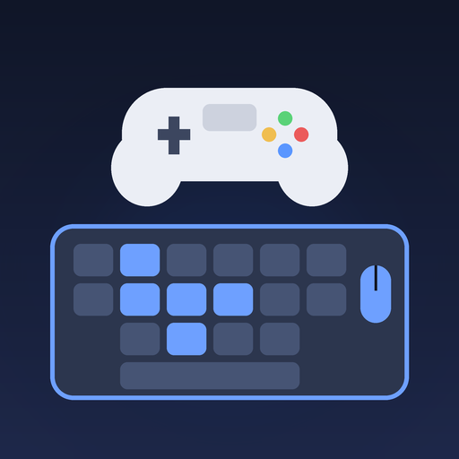

# kbm_pad — teclado y ratón como mando (plugin GoldHEN)

<p align="center">
  
</p>

<p align="center">
  <b>kbm_manager</b> — app PKG para instalar y activar el plugin desde la PS4<br>
  <a href="https://github.com/Y4ll/-ps4-kbm-pad/releases/download/manager/kbm_manager.pkg"><b>⬇ Descargar kbm_manager.pkg</b></a>
</p>

Plugin `.prx` para GoldHEN que engancha `scePadRead` / `scePadReadState` del juego
y mezcla en los datos del mando las entradas de un teclado y un ratón USB.

> **Estado: sin probar en consola.** Compila contra los headers de OpenOrbis, pero
> no se ha enlazado ni ejecutado en una PS4. Ver "Cosas por verificar".

## Controles

| Entrada | DualShock 4 |
|---|---|
| W A S D | Stick izquierdo |
| Movimiento del ratón | Stick derecho |
| Clic izquierdo / derecho | R2 / L2 |
| Espacio / E / Q / R | Cruz / Círculo / Cuadrado / Triángulo |
| F / G | L1 / R1 |
| Shift / Ctrl | L3 / R3 |
| Flechas | D-pad |
| Enter / Tab | Options / Touchpad |
| **F8** | Activar / pausar el plugin |

Ajustes (sensibilidad, inercia, invertir Y, tecla de pausa) al inicio de `src/main.c`.

## Control desde una app (kbm_manager)

El plugin vigila `/data/GoldHEN/kbm_pad.ini` cada ~2 s y recarga solo cuando cambia
(F6 sigue funcionando). Para activar o pausar desde una app basta con escribir en ese
archivo la línea `activo=1` (encendido) o `activo=0` (pausa; el mando funciona normal).
Cualquier otro ajuste del `.ini` (sensibilidad, teclas, botones) se aplica igual.

El plugin publica su estado en `/data/GoldHEN/kbm_pad.status`, por ejemplo:

```
version=6
activo=1
conducir=0
teclado=1
raton=1
sens=6.0
```

F8 sigue pausando/activando dentro del juego; el estado real siempre está en `.status`.

## Compilar (Linux o macOS)

1. Instala el [OpenOrbis PS4 Toolchain](https://github.com/OpenOrbis/OpenOrbis-PS4-Toolchain)
   **ya compilado** (release con `lib/` y `bin/`), más `clang` y `ld.lld` (LLVM 10+).
2. ```
   export OO_PS4_TOOLCHAIN=/ruta/al/OpenOrbis-PS4-Toolchain
   make
   ```
3. Resultado: `kbm_pad.prx`.

El SDK de plugins de GoldHEN (MIT) viene incluido en `sdk/`.

### Compilar en GitHub (sin instalar nada)

El repo incluye `.github/workflows/build.yml`, que compila el plugin con la imagen
Docker oficial de OpenOrbis (`openorbisofficial/toolchain`).

1. En GitHub, abre la pestaña **Actions** del repo.
2. Elige **Build kbm_pad.prx** y pulsa **Run workflow** (también corre solo en cada push a `main`).
3. Cuando termine, abre la ejecución y descarga el artefacto **kbm_pad-prx** (un zip con `kbm_pad.prx`).

Si falla en el enlace, el paso "Show available stub libraries" lista las librerías del
toolchain; si faltan `libSceMouse` o `libSceKeyboard`, ese es el problema.

## Instalar en la PS4

1. Copia `kbm_pad.prx` a `/data/GoldHEN/plugins/`.
2. Actívalo en `/data/GoldHEN/plugins.ini` (o el archivo de plugins de tu versión de GoldHEN):
   ```
   [default]
   /data/GoldHEN/plugins/kbm_pad.prx
   ```
   Para un solo juego, usa su título en vez de `[default]`, por ejemplo `[CUSA00000]`.
3. Conecta el teclado y el ratón por USB y abre el juego.

En el jailbreak para 13.00–13.52 el exploit no persiste: hay que cargar GoldHEN tras cada reinicio.

## Cosas por verificar

- **Ratón:** `libSceMouse` no está documentada en OpenOrbis. La estructura de datos
  (`KbmMouse`) y los bits de los botones son una suposición; si el ratón no responde
  o va invertido, empieza por ahí.
- **Librerías de enlace:** el `Makefile` usa `-lSceMouse` y `-lSceKeyboard`. Si tu
  toolchain no trae esos stubs, el enlace fallará y habrá que resolverlas en tiempo
  de ejecución con `sceKernelDlsym`.
- **Juegos:** solo funciona con juegos que lean el mando con `scePadRead` o
  `scePadReadState`. Algunos usan variantes (`...Ext`) que aún no están enganchadas.
- **Logs:** el plugin escribe al klog con el prefijo `[kbm_pad]`; ahí verás si se
  abrieron el teclado y el ratón.

## App kbm_manager (PKG)

App para la PS4 que descarga el plugin, lo instala en `/data/GoldHEN/plugins/`, lo añade a `plugins.ini` y lo activa o desactiva (escribe `activo=1/0` en `kbm_pad.ini`). Se compila en GitHub Actions (`build-app.yml`) y el `.pkg` queda en la release **manager**.
Controles: X instalar/actualizar, Cuadrado activar/desactivar, Triángulo desinstalar, Círculo salir.
